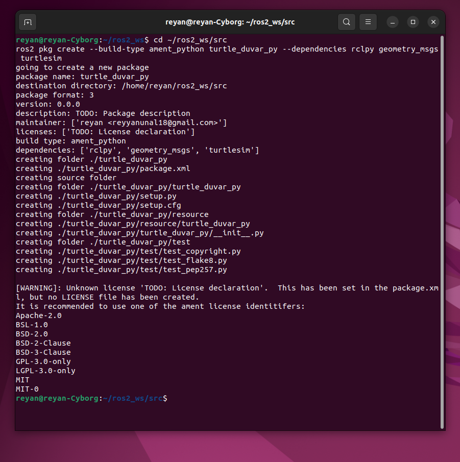
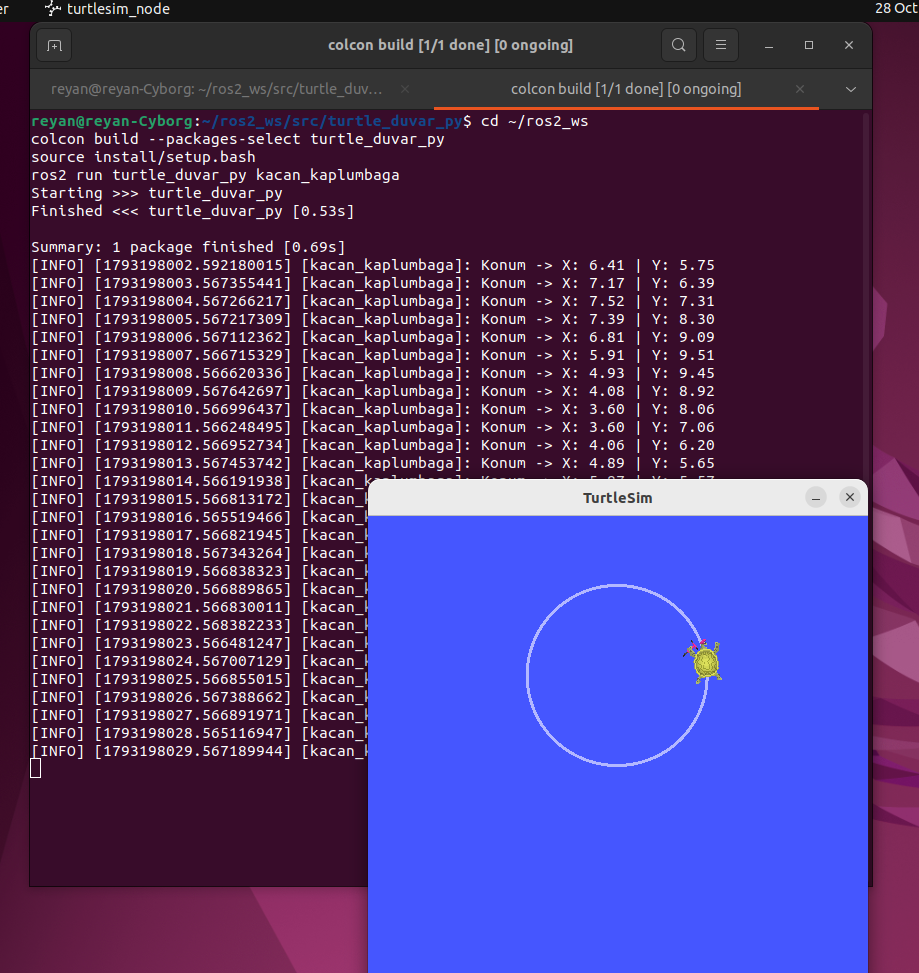
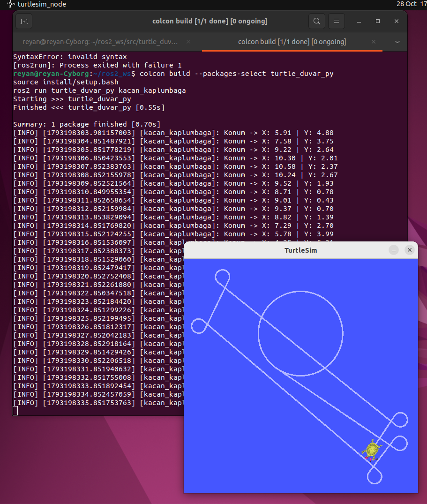
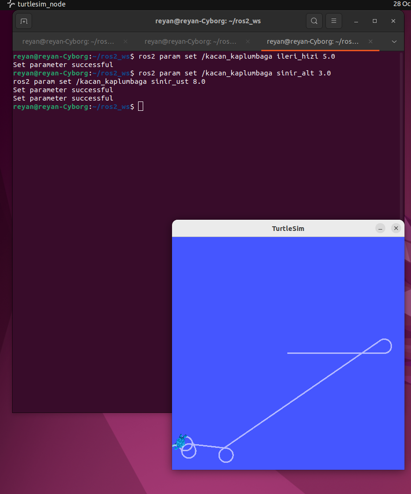

# ROS 2 Duvardan Kaçan Kaplumbağa Projesi

Bu proje, ROS 2 Humble kullanılarak geliştirilmiş otonom bir turtlesim uygulamasıdır. Kaplumbağa, belirli sınırlar içinde hareket eder ve sınırlara yaklaştığında kavisli bir kaçış manevrası yapar.

## Proje Adımları ve Kanıtlar

### 1. Paket Oluşturma
`turtle_duvar_py` paketi `rclpy`, `geometry_msgs` ve `turtlesim` bağımlılıkları ile `ament_python` formatında oluşturulmuştur.

### 2 ve 4. Abone (Subscriber) ve Loglama
`/turtle1/pose` konusuna abone olunarak kaplumbağanın anlık x ve y koordinatları dinlenmiş, `get_logger().info()` kullanılarak saniyede bir kez terminale yazdırılmıştır.

### 3. Yayıncı (Publisher) ile Duvardan Kaçış
Kaplumbağa `/turtle1/cmd_vel` konusu üzerinden sürülmüştür. Koordinatlar (x veya y) 1.0'dan küçük veya 10.0'dan büyük olduğunda, kaplumbağa ileri gidiş hızını düşürüp dönüş yaparak güvenli bölgeye kaçmaktadır.

### Bonus: Dinamik Parametreler
Kaplumbağanın ileri hızı, dönüş hızı ve duvar sınır değerleri (alt ve üst limitler) ROS 2 parametreleri olarak tanımlanmıştır. Düğüm çalışırken dışarıdan `ros2 param set` komutu ile dinamik olarak güncellenebilmektedir.

